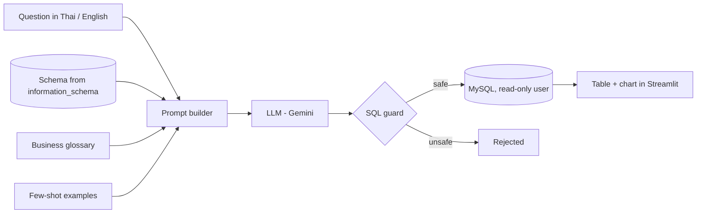

# Coffee Chain Text-to-SQL

Ask business questions in **Thai or English** and get answers from a MySQL database.
An LLM turns the question into SQL, a safety layer checks it, and the result is shown as a table and chart.

Built on top of my [coffee-chain-database](https://github.com/Pingxi57/coffee-chain-database)
project (MySQL 8, 15 tables, 200,000+ orders).


## Highlights

| | |
|---|---|
| **Natural language → SQL** | Thai and English questions, answered with real queries on 200k+ orders |
| **Business context** | A glossary of business rules and few-shot examples taken from my own analytics queries |
| **Safety** | Read-only MySQL user, single `SELECT` only, blocked functions, auto `LIMIT`, 10 s timeout, unit tests |
| **Evaluation** | 30 gold questions (easy / medium / hard), scored by comparing query *results*, with an ablation study |
| **UI** | Streamlit chat with result table, generated SQL and an automatic chart |

## How it works



1. **Schema** is read live from `information_schema` (tables, views, columns, keys, foreign keys).
2. **Business rules** (`context/glossary.md`) tell the model things it cannot guess from the schema, for example:
   - the data ends on 2026-09-30, so "today" means 2026-09-30 and `CURDATE()` must not be used
   - "sales" means *net* sales and "revenue" means successful payments
   - cancelled orders are excluded
3. **Few-shot examples** (`context/examples.sql`) are adapted from the analytics queries in the database project.
4. **SQL guard** (`app/guard.py`) parses the query with `sqlglot` before it runs.

## Safety (defense in depth)

1. The app connects as a MySQL user that only has `SELECT` and `SHOW VIEW` (`setup/create_readonly_user.sql`).
2. `app/guard.py` allows exactly one `SELECT` / `WITH` statement, blocks data-changing statements and
   functions like `SLEEP()`, and adds `LIMIT 500` if the model forgot one.
3. Every query runs with `MAX_EXECUTION_TIME = 10 s`.
4. `tests/test_guard.py` checks the guard with pytest.

## Evaluation

`eval/questions.sql` holds 30 questions with hand-written gold SQL (10 easy, 12 medium, 8 hard),
half in Thai and half in English, and different from the few-shot examples.

A prediction counts as correct when it returns the same number of rows and every gold column
appears in the prediction's result (extra columns are allowed, numbers are rounded to 1 decimal).

The same questions are run with four prompt settings to see what each part adds:

| Configuration | What the prompt contains |
|---|---|
| `schema_only` | schema |
| `glossary` | schema + business rules |
| `examples` | schema + few-shot examples |
| `full` | schema + business rules + few-shot examples |

**Results:** _coming soon - see `eval/results.md`._

## Project structure

```
coffee-chain-text2sql/
├── app/
│   ├── schema_context.py   # reads the schema from information_schema
│   ├── llm.py              # LLM API wrapper (provider can be swapped)
│   ├── ask.py              # prompt building, SQL generation and execution
│   ├── guard.py            # SQL safety checks
│   └── ui.py               # Streamlit chat UI
├── context/
│   ├── glossary.md         # business rules
│   └── examples.sql        # few-shot examples
├── eval/
│   ├── questions.sql       # 30 gold questions
│   └── run_eval.py         # evaluation runner
├── setup/
│   └── create_readonly_user.sql
├── tests/
│   └── test_guard.py
└── .env.example
```

## Run it yourself

1. Set up the database from [coffee-chain-database](https://github.com/Pingxi57/coffee-chain-database)
   (schema, seed data and views).
2. Create the read-only user: run `setup/create_readonly_user.sql` as root (change the password first).
3. Install and configure:

   ```bash
   conda create -n text2sql python=3.11 -y
   conda activate text2sql
   pip install -r requirements.txt
   cp .env.example .env   # then fill in the DB password, Gemini API key and model name
   ```

4. Run:

   ```bash
   streamlit run app/ui.py                 # web UI
   python app/ask.py "สาขาไหนขายดีที่สุด"     # terminal
   pytest                                  # tests
   python eval/run_eval.py --check-gold    # check the gold SQL
   python eval/run_eval.py --config full   # run the evaluation
   ```

## Limitations and next steps

- Self-correction: send the MySQL error back to the model and retry.
- Larger schemas: retrieve only the relevant tables (vector search) instead of sending the whole schema.
- The free Gemini tier has a small daily request limit, so evaluation runs over several days.
- All data is synthetic.

## Tech

Python · MySQL 8 · Gemini API · sqlglot · Streamlit · pandas · pytest
