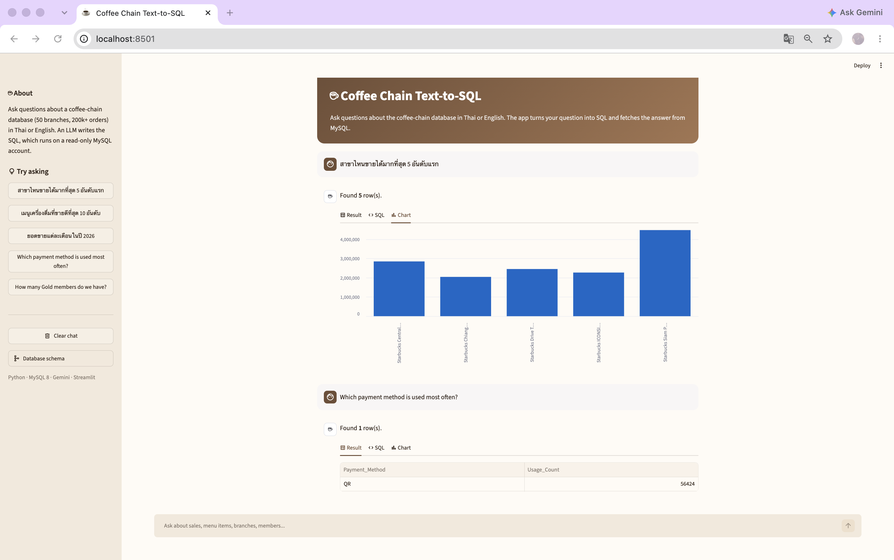

# Coffee Chain Text-to-SQL

Ask business questions in **Thai or English** and get answers from a MySQL database.
An LLM turns the question into SQL, a safety layer checks it, and the result is shown as a table and chart.

Built on top of my [coffee-chain-database](https://github.com/Pingxi57/coffee-chain-database)
project (MySQL 8, 15 tables, 200,000+ orders).



## Highlights

| | |
|---|---|
| **Natural language → SQL** | Thai and English questions, answered with real queries on 200k+ orders |
| **Business context** | A glossary of business rules, few-shot examples from my own analytics queries, and allowed column values read from CHECK constraints |
| **Safety** | Read-only MySQL user, single `SELECT` only, blocked functions, auto `LIMIT`, 10 s timeout, unit tests |
| **Evaluation** | 30 gold questions scored by comparing query *results*: **37% → 87% → 90%** as context is added |
| **UI** | Streamlit chat with result table, generated SQL and an automatic chart |

## How it works


1. **Schema** is read live from `information_schema`: tables, views, columns, keys, foreign keys,
   and the CHECK constraints that list the allowed values of each status or type column.
2. **Business rules** (`context/glossary.md`) tell the model things it cannot see in the schema, for example:
   - the data ends on 2026-09-30, so "today" means 2026-09-30 and `CURDATE()` must not be used
   - "sales" means *net* sales and "revenue" means successful payments
   - cancelled orders are excluded
3. **Few-shot examples** (`context/examples.sql`) are adapted from the analytics queries in the database project.
4. **SQL guard** (`app/guard.py`) parses the query with `sqlglot` before it runs.

## Safety (defense in depth)

1. The app connects as a MySQL user that only has `SELECT` and `SHOW VIEW` (`setup/create_readonly_user.sql`).
2. `app/guard.py` allows exactly one `SELECT` / `WITH` statement, blocks data-changing statements and
   functions like `SLEEP()`, and adds `LIMIT 500` if the model forgot one.
3. Every query runs with `MAX_EXECUTION_TIME = 10 s`.
4. `tests/test_guard.py` checks the guard with pytest.

## Evaluation

### Method

`eval/questions.sql` holds 30 questions with hand-written gold SQL (10 easy, 12 medium, 8 hard),
half in Thai and half in English, and different from the few-shot examples.

Both the generated SQL and the gold SQL are run on the database, and their **results** are compared,
not the SQL text, because different SQL can be equally correct. A prediction counts as correct when it
returns the same number of rows and every gold column appears in its result (extra columns are allowed,
numbers may differ by ±0.05).

The same 30 questions were run with three prompt settings:

| Configuration | What the prompt contains |
|---|---|
| `schema_only` | schema |
| `full` | schema + business rules + few-shot examples |
| `full_v2` | `full` + allowed column values from CHECK constraints |

Model: Gemini Flash (free tier), one run per configuration. The runner also supports `glossary`-only
and `examples`-only settings, which were not run because of the free tier's daily request limit.

### Results

| Configuration | Easy (10) | Medium (12) | Hard (8) | Overall |
|---|---|---|---|---|
| `schema_only` | 70% | 33% | 0% | **37%** (11/30) |
| `full` | 90% | 83% | 88% | **87%** (26/30) |
| `full_v2` | 100% | 83% | 88% | **90%** (27/30) |

Raw results with every generated query: `eval/results.csv`.

**Key findings**

- **Business context is what matters most.** Adding the glossary and examples raised accuracy from
  37% to 87%, and on hard questions from 0% to 88%. The model could write the SQL; what it was missing
  were rules that the schema cannot express.
- **Allowed values fixed the error they were designed for.** `full_v2` fixed Q08 (wrong status value),
  but the overall gain over `full` is one question, which is within the run-to-run variation of the model.

### Error analysis

**Why `schema_only` failed (19 questions).** A keyword check on the failed SQL shows the main causes:

| Cause | Questions |
|---|---|
| Counted cancelled orders | about 10 |
| Used the real current date (`CURDATE()`) instead of 2026-09-30 | 3 |
| Other: gross vs net sales, wrong status values, different period | the rest |

**Why `full` failed (4 questions)**, checked by hand:

| Question | What went wrong | Verdict |
|---|---|---|
| Q08 Branches under renovation | Used `'Under Renovation'`; the stored value is `'Renovation'` | Wrong |
| Q21 Slowest delivery branches | Did not keep only `Delivery_Status = 'Delivered'`; top 4 match, 5th place swaps (0.03 min apart) | Wrong (near miss) |
| Q22 Points earned vs redeemed | Split points by the sign of `Points_Change` instead of `Txn_Type`, so expired points counted as redeemed | Wrong |
| Q29 Branches with the highest promotion share | Returned a ratio (0.123) instead of a percentage (12.3); same ranking | Correct in meaning |

After manual review, `full` answers **27/30 (90%)** correctly.

**`full_v2`.** Q08 and Q29 now pass. Q21 and Q22 still fail, so knowing the allowed values was not
enough for the model to apply them. Q23 passed under `full` but failed under `full_v2`, a reminder that
LLM output varies between runs and a single run per setting gives only a rough estimate.

**Fixes to the measuring tool.** During error analysis, two changes were made to the evaluator itself
and applied to all configurations by re-scoring the stored queries (`--rescore`, no new LLM calls):
a small numeric tolerance (one answer was rejected only because of rounding), and the gold SQL for Q21
was aligned with the project's own business rules.

## Project structure

```
coffee-chain-text2sql/
├── app/
│   ├── schema_context.py   # schema, foreign keys and CHECK constraints from information_schema
│   ├── llm.py              # LLM API wrapper (provider can be swapped)
│   ├── ask.py              # prompt building, SQL generation and execution
│   ├── guard.py            # SQL safety checks
│   └── ui.py               # Streamlit chat UI
├── context/
│   ├── glossary.md         # business rules
│   └── examples.sql        # few-shot examples
├── eval/
│   ├── questions.sql       # 30 gold questions
│   ├── run_eval.py         # evaluation runner (resumable, rate-limit aware)
│   ├── results.csv         # every generated query and its score
│   └── results.md          # summary table
├── setup/
│   └── create_readonly_user.sql
├── tests/
│   └── test_guard.py
└── .env.example
```

## Run it yourself

1. Set up the database from [coffee-chain-database](https://github.com/Pingxi57/coffee-chain-database)
   (schema, seed data and views).
2. Create the read-only user: run `setup/create_readonly_user.sql` as root (change the password first).
3. Install and configure:

   ```bash
   conda create -n text2sql python=3.11 -y
   conda activate text2sql
   pip install -r requirements.txt
   cp .env.example .env   # then fill in the DB password, Gemini API key and model name
   ```

4. Run:

   ```bash
   streamlit run app/ui.py                    # web UI
   python app/ask.py "สาขาไหนขายดีที่สุด"        # terminal
   pytest                                     # tests
   python eval/run_eval.py --check-gold       # check the gold SQL (no LLM calls)
   python eval/run_eval.py --config full_v2   # run an evaluation (continues where it stopped)
   python eval/run_eval.py --rescore          # re-score stored queries (no LLM calls)
   ```

## Limitations and next steps

- One run per configuration; repeating each run several times would give more reliable numbers.
- Self-correction: send the MySQL error or an empty result back to the model and let it retry.
- Larger schemas: retrieve only the relevant tables (vector search) instead of sending the whole schema.
- The free Gemini tier has a small daily request limit, so evaluation runs over several days.
- All data is synthetic.

## Tech

Python · MySQL 8 · Gemini API · sqlglot · Streamlit · pandas · pytest
